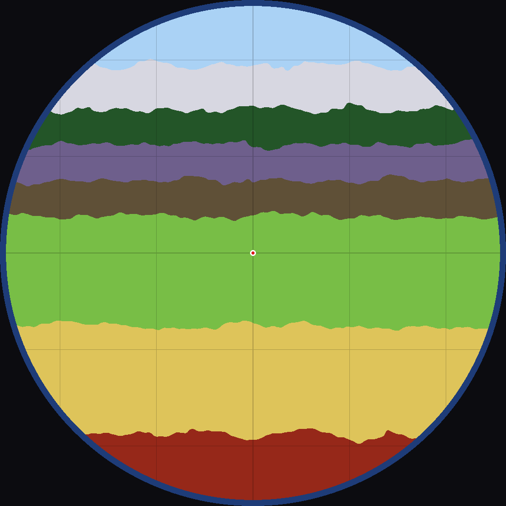
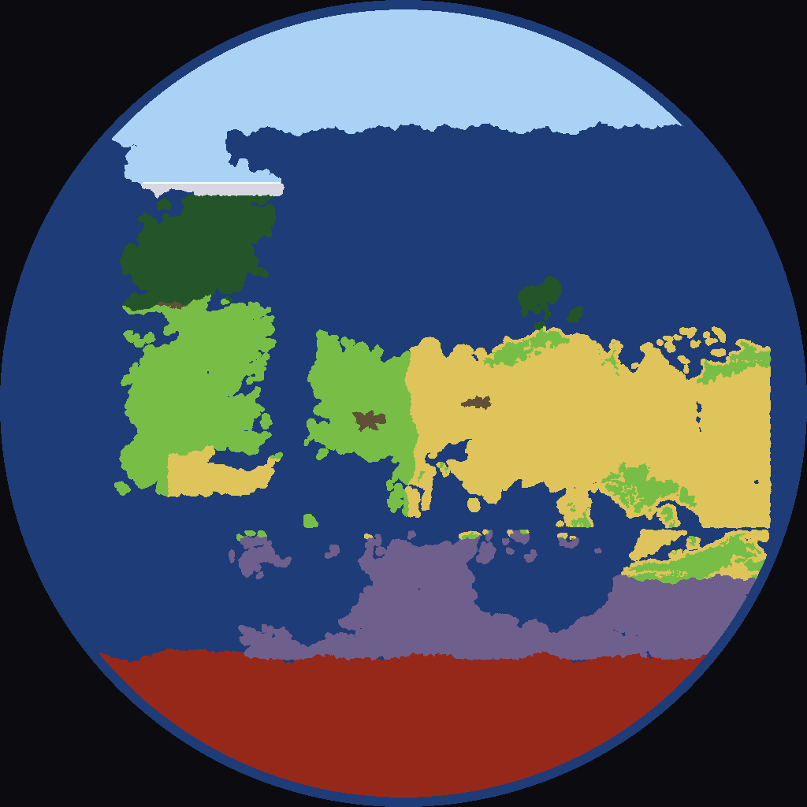

- Startpunkt und Magierturm liegen in der Mitte von Westeros. Die Orte haben (vorerst) keine
  Portale, sondern sind auf der Karte mit dem Haus-Symbol markiert; hin kommt man mit
  `bg_tp Ortsname`.
# Valheim Mods

Eigene Mods für Valheim, gebaut mit BepInEx und Harmony.

## Mods

### Breitengrade

Kein Ozean mehr: Die Welt ist ein großer Kontinent, und die Biome liegen wie Klimazonen
von Süden nach Norden:

Ashlands → Plains → Meadows → Swamp → Mistlands → Black Forest → Mountain → Deep North



- Gilt **nur** für Welten mit dem Namen aus der Config (Standard: `Breitengrade`).
  Alle anderen Welten bleiben unverändert.
- Grenzen, Welligkeit, Mindesthöhe und Berg-Anhebung lassen sich in
  `BepInEx\config\aron.valheim.breitengrade.cfg` einstellen.
- Die Bandbreiten orientieren sich an den Flächenanteilen normaler Welten,
  Meadows liegt aber immer in der Mitte (Startpunkt).
- Die Anzahl der Strukturen (Krypten, Dungeons, Dörfer, Türme …) wird an die Fläche
  jedes Bioms angepasst, damit die Dichte wie in normalem Valheim bleibt. Grundlage ist
  die Biom-Fläche je 500-m-Ring um die Weltmitte, gemessen an einer normalen Welt.
- Strukturen, die nur in einem bestimmten Abstand zur Mitte erscheinen dürfen, bekommen
  einen größeren Abstandsbereich, wenn ihr Biom bei uns woanders liegt.
- Ashlands und Deep North sind festes Land, ohne Meeresflächen.
- Großes Meer östlich vom Start (Wasser ca. 1/8 der Karte) mit einer großen Insel
  (ca. 1/20 der Karte): im Norden Meadows, im Süden Plains. Position und Größe sind
  in der Config einstellbar (Abschnitt `Meer`). Dort gibt es auch wieder Wasser-Orte
  wie Schiffswracks, in passender Dichte.
- Geländehöhe nach Breitengrad: südlich des Black Forest so hoch wie normales Land
  (Valheim färbt hohes Gelände verschneit), im Black Forest nach Norden ansteigend mit
  Schneekuppen, ab Mountain frei (`HoeheSueden`, `HoeheNordrandBlackForest`).
- Ashlands als eine große Hauptinsel: Valheim unterscheidet Hauptinseln (großes Land,
  viel Lava) und Nebeninseln (klein, kaum Lava). Das ganze Band gilt als Hauptinsel
  (`AshlandsHauptinsel`, 0 bis 1).
- Weltgröße einstellbar (`Weltgroesse`, Standard 3 = 30 km Radius statt 10 km). Bänder,
  Meer, Strukturmengen, Karte, Weltrand und das Biom-Raster wachsen mit. Andere Welten
  bleiben normal groß. Eine neue Welt dauert beim Erstellen deutlich länger.
- Konsolenbefehl `bg_hier` (F5): schreibt die Biom-Daten der eigenen Position ins Log.
- `god` gibt zusätzlich unendliche Ausdauer, `bg_ausdauer` schaltet sie auch ohne God-Modus an/aus.
- Große Karte: unter dem Biom-Namen stehen X, Z und die Bodenhöhe unter dem Mauszeiger.
- `bg_tp X Z`, `bg_tp X Höhe Z` oder `bg_tp Markierungsname`: Teleport. `bg_pins` listet alle
  Markierungen mit Koordinaten. Portal „Weltrand-Test“ am Start führt an den äußersten Landpunkt.
- Fotos (zum Prüfen der Städte): `bg_foto` (Stadt in der Nähe), `bg_foto Name`, `bg_foto hier`
  (rundum von der eigenen Position) und `bg_rundgang [ab Nummer]` (alle Städte nacheinander).
  Mittag, klares Wetter, ohne Anzeigen; Bilder landen in `Valheim/BepInEx/fotos/`.
- `bg_wasser` schreibt zusätzlich alle Renderer mit Ashlands-Wasserwerten in der Nähe ins Log.
- **Fernsteuerung (Entwicklung):** Der Stadtbau steckt in einem eigenen Modul
  (`Breitengrade.Bau/`, wird nach `Valheim/BepInEx/breitengrade_bau/` gebaut) und kann im laufenden
  Spiel neu geladen werden. Befehle in `Valheim/BepInEx/claude/befehl.txt` (eine Zeile je Befehl)
  führt die Mod im Spiel aus und schreibt die Ergebnisse nach `antwort.txt`:
  `laden`, `neu Stadt` (abreißen und neu bauen), `foto Stadt [1,2,8]`, `kamera x y z bx by bz name`,
  `tp Stadt`, `teile` (alle Bauteile mit Maßen), `staedte`. Das Spiel läuft dafür auch im Hintergrund weiter.
- Weltgröße höchstens 1,55: Größer würde Valheims Objektraster (512 × 512 Felder à 64 m)
  sprengen; dessen Speicherformat ist an mindestens acht Stellen fest darauf ausgelegt.
- Leistungsprotokoll (`LeistungsProtokoll`): alle 15 Sekunden FPS, Objekte, Kreaturen und
  Geländeaufrufe im Log unter `[Leistung]`.
- Magierhaus (`Magierhaus`): Auf einem hohen, steilen Podest in den Meadows (westlich vom
  Start, Höhe `PodestHoehe`) steht eine Halle aus schwarzem Marmor mit Galdr-Tisch, Thron und
  Feuerschalen, daneben ein Portalturm mit mehreren Etagen (verbunden durch Treppen an der
  Südwand, je Etage eigenes Licht). Am Start steht nur ein Portal „Magierhaus“. Die Bauten brauchen keine
  Stütze, nehmen keinen Schaden, die Feuer brennen ewig. Vorbild: „The Wizard's Rook“.
- Ohne Magierhaus: Portal-Platz am Start. Der Boden um die Weltmitte wird eingeebnet (100 m, `SpawnEinebnen`).
  Darauf stehen zwei Ringe aus Portalen:
  - innen je eins in jedes andere Biom plus „Insel Meadows“ und „Insel Plains“,
  - außen Reisepunkte, je Band vier über die Breite verteilt („Plains Fernwest“, „Plains West“,
    „Plains Ost“, „Plains Fernost“ …).
  Alle Ziele werden auf der Karte markiert (`TestPortale`, `Reisepunkte`, `PortaleAufKarte`).
- Die Bänder werden intern in Teilgebiete zerschnitten, damit Biom-Varianten
  (z. B. „Dark Meadows“, „Bog Swamp“) und ihre speziellen Orte entstehen können.
- Im Multiplayer brauchen alle Spieler (und der Server) die Mod.
- Ohne Ozean gibt es keine Seeschlangen, Leviathane und Schiffswracks.
- Im Log (`BepInEx\LogOutput.log`) stehen unter `[Strukturen]` und `[Diagnose]`
  die angepassten Mengen und die Biom-Varianten.

Vorschau der Karte ohne Spielstart (`tools/BiomVorschau`):

```
dotnet run -- ../../biom-vorschau.png [seed] [grenzen] [welligkeit]
```

### Planetos

Eine zweite Welt-Variante: Welten mit dem Namen **Planetos** werden nach einer groben
Biom-Karte von Planetos (Westeros, Essos, Sothoryos und die fernen Kontinente) aufgebaut.



- Norden/Schnee → Deep North, Süden → Ashlands (Hauptinsel), Grasland → Meadows,
  nördliches Grasland → Black Forest, Wüste → Plains, Dschungel → Mistlands,
  Mountain als Streifen südlich der Mauer, ein paar Sümpfe in der Mitte (Essos, die Eng).
- **Die Mauer**: ein sehr hoher, schmaler Wall quer über Westeros (`MauerHoehe`, Standard 260 m),
  ohne Lücke von der West- bis zur Ostküste. Sie ist die Grenze: südlich Mountain, nördlich und
  oben Deep North. Auf der Mauer wächst nichts, es erscheinen keine Kreaturen und keine Locations.
- **Städte** an den Orten (nach einer Karte mit Ortsnamen), selbst gebaut aus Bauteilen wie das
  Magierhaus: eine eingeebnete Fläche (so groß wie früher eine Meadows-Stadt, große Orte größer),
  Stadtmauer mit Türmen und Toren, ein Straßenkreuz, Häuser in Blöcken und ein Wahrzeichen nach
  der Lore – z. B. Winterfell (Great Keep, Türme, Broken Tower, Godswood frei, doppelte Mauer),
  King's Landing (Red Keep, Great Sept mit sieben Türmen, Dragonpit), Oldtown (gestufte Hightower
  mit Leuchtfeuer, Citadel), Meereen/Astapor/Old Ghis (Stufenpyramiden), Harrenhal (fünf riesige,
  teils zerfallene Türme), Vaes Dothrak (Horse Gate, Godsway, Zelte), Storm's End (Rundturm),
  Braavos (Titan), Asshai (schwarzer Stein), Valyria/Yeen/Land of Fire (Ruinen), Hardhome und
  Thenn (Hütten), The Neck (Pfahlbauten). Material und Dachform je Ort (Holz, dunkles Holz, Stein,
  schwarzer Marmor, Grausten). Häuser in mehreren Formen (einfach, zweistöckig, L-Form,
  Wohnturm, mit Schornstein oder Vordach), mit Türen zur Straße und etwas Einrichtung; Fackeln an
  den Hauptstraßen, Brunnen und Marktstände am Platz. Alle Bauteile sind geschützt. Die Städte werden einmal je Welt
  geplant (`BepInEx/config/Breitengrade/staedte_<Welt-ID>.txt`) und dann eine pro Sekunde gebaut.
  Auf der Karte hat jede Stadt ein Haus-Symbol.
- **Straßen** zwischen den Städten, direkt in die Geländetextur gemalt (keine Bauteile): die großen
  Straßen nach King's Landing (Kingsroad bis Castle Black, Roseroad bis Oldtown, Goldroad, nach
  Storm's End und Harrenhal) gepflastert, alle anderen als Feldweg. Die Wege werden um Wasser und
  Berge herum gesucht und einmal je Welt gespeichert (`strassen_<Welt-ID>.txt`). An den
  Stadtausgängen und alle 1,5 km stehen Wegweiser (Pfosten mit Schildern: Ziel, Pfeil, Entfernung).
  In den Städten: gepflasterte oder erdige Hauptstraßen und Platz, Gassen zwischen den Häusern,
  Gärten mit Zaun und Baum, Marktstände mit Dach, Bäume, Holzstapel, Banner an den Burgen.
- **Ruinen** haben keine Löcher: Die Bauteile sind stark beschädigt (Risse) und die Gebäude
  unterschiedlich hoch abgebrochen, ohne Dach. In normalen Städten zeigen einzelne Teile Altersspuren.
- Die Biom-Karte (`Breitengrade/Planetos.biome.gz`) wird mit
  `tools/PlanetosKarte/umwandeln.py` aus einer Fan-Karte erzeugt. Die Fan-Karte selbst
  liegt nicht im Repo.

## Voraussetzungen

- Valheim (Steam)
- [BepInExPack_Valheim](https://thunderstore.io/c/valheim/p/denikson/BepInExPack_Valheim/) im Valheim-Ordner
- .NET SDK 8

## Bauen

Im Ordner einer Mod:

```
dotnet build
```

Die fertige DLL wird automatisch nach `Valheim\BepInEx\plugins` kopiert.
Liegt Valheim nicht im Standard-Steam-Ordner, eine `Directory.Build.user.props`
anlegen und dort `ValheimPath` setzen.

## Hinweis

Spiel-DLLs (z. B. `assembly_valheim.dll`) und Spielstände gehören nicht ins Repo.
Das Projekt verweist nur auf den lokalen Valheim-Ordner.
